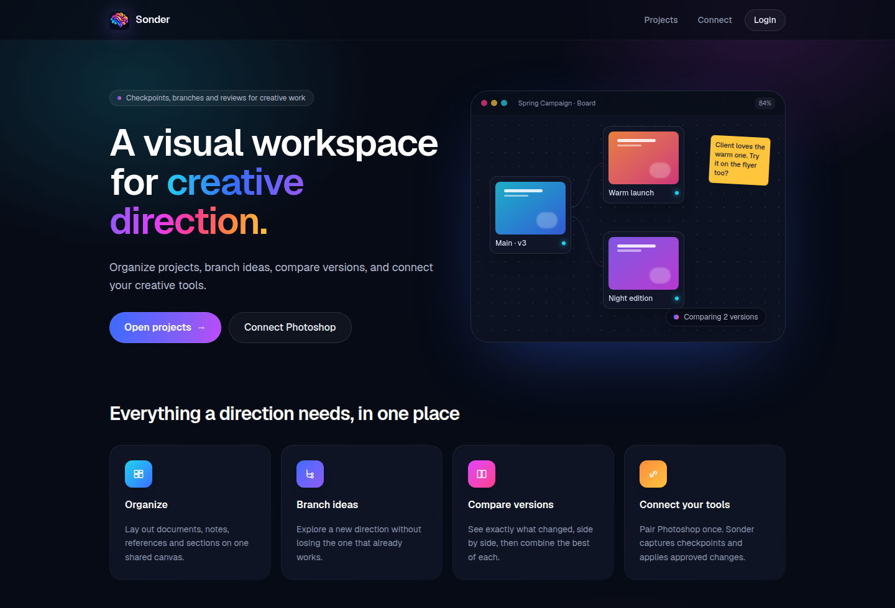

# Sonder

Hacklanta 2026 sponsored by Adobe

Collaborative visual workspace for creative projects across multiple applications. See
`Design_Plan.md` for the plan, `docs/setup.md` for full setup details, and `docs/progress.md`
for status.

[](https://www.sondr.design/)

## Try it yourself

You need **Photoshop 2026**, Node.js 20.9+, pnpm, Python 3.12, and a Supabase project. Sonder
has been tested on macOS only. See [Prerequisites](docs/setup.md#prerequisites) for exact
versions.

### 1. Install and configure

```sh
pnpm install
cp apps/web/.env.example apps/web/.env.local     # fill in your Supabase URL and keys
```

Then follow sections 2–4 of [docs/setup.md](docs/setup.md) to set up the vision service and
environment variables, apply the database migrations (`supabase db push`), and set the auth
redirect URLs.

### 2. Start the app

Run each in its own terminal:

```sh
pnpm dev                                                       # web: http://localhost:3000
cd services/vision && .venv/bin/uvicorn sonder_vision.main:app --app-dir src --port 8000
pnpm --filter @sonder/connector-photoshop watch                # builds the Photoshop panel
```

### 3. Load the Photoshop panel

1. In Photoshop 2026, go to **Settings → Plugins**, check **Enable Developer Mode**, then
   restart Photoshop.
2. Install **UXP Developer Tool** from the Creative Cloud app.
3. In UXP Developer Tool, click **Add Plugin**, select
   `connectors/photoshop/plugin/manifest.json`, then click **Load & Watch**.
4. In Photoshop, open **Plugins → Sonder → Sonder**.

If loading fails, see [Photoshop connector](docs/setup.md#5-photoshop-connector) for
troubleshooting.

### 4. Sign in and create a project

1. Open <http://localhost:3000/login>, enter an email and password, and click **Sign up**.
   Confirm your address from the email Supabase sends, then sign in.
2. Go to <http://localhost:3000/projects>, create a project, and open it. The canvas starts
   empty.

### 5. Connect Photoshop

1. In the Sonder panel, click **Connect**. It shows a code such as `ABCD-2345`.
2. Open <http://localhost:3000/pair> (the **Connect** guide, opened at the code step), enter the
   code, and click **Approve**. The panel changes to "Connected as …". The connection is
   remembered for 30 days of use, so you normally pair once.

### 6. Link a document

1. In Photoshop, open or create a PSD with a text layer and a solid color fill layer, then
   save it.
2. In the panel, pick your project (click **Reload** if it isn't listed) and click
   **Link active document**.
3. A card for the document appears on the canvas within about 15 seconds. Refresh the page if
   it doesn't.

### 7. Explore

Click the document card to open the inspector:

- **Capture** saves a checkpoint. The first capture creates the `main` branch.
- Edit something in Photoshop, save, and **Capture** again to build history.
- Click an earlier checkpoint, type a name, and click **Branch from here**.
- Click **Switch** next to a branch. Photoshop opens that version as a separate working copy;
  your original file is never overwritten. Unsaved or uncaptured changes block the switch with
  a message. For uncaptured changes, **Switch anyway** is offered.
- Tick two checkpoints and click **Compare** to see them side by side, with changed properties
  highlighted.
- With two branches, click **Combine branches…**. Pick the branch to combine into and the one
  to take changes from, choose per property (conflicts must be resolved), and click **Create
  candidate**. Photoshop builds the result as a separate copy. Review its preview next to both
  branches, then **Approve and finalize** (or **Discard**), and **Open result in the app**.

On the canvas:

- Use the tool rail on the left to place notes, text, sections, themes and directions, or to
  add a reference image (PNG, JPEG or WebP).
- Drag cards to arrange them. Positions are saved.
- Drag from one card's edge dot to another to connect them. Connections are for organizing
  only and never change version history.
- Select a note, reference or connection and press Delete to remove it.

Captures and branch switches run only while the Sonder panel is open and connected.

### 8. Seed a demo project

With Photoshop open and the panel connected, this builds a ready-made project (as the
connected user) for showing branches:

```sh
pnpm --filter web seed:branching-demo -- "Branching Demo"
```

It creates "Spring Poster" with `main` (three versions), `warm-launch` and `night-edition`
(both from the second version), and `warm-serif` (a branch of `warm-launch`), plus notes on
the canvas suggesting what to try. It takes about two minutes and leaves `main` open in
Photoshop.

For a project that covers every version feature (capture, compare, restore, switch, combine,
themes and directions):

```sh
pnpm --filter web seed:feature-demo -- "Sonder Demo"
```

It creates "Spring Poster" (the branches above, plus a fourth `main` version with a lime
background to restore from) and "Spring Flyer" (two versions). It also adds the themes
"Sunset" and "Midnight", already mapped to both documents' headline, body and background, and
the directions "Client shortlist" and "Night launch". Numbered notes on the canvas walk
through the demo. It takes about three minutes and leaves both documents open in Photoshop on
`main`.
